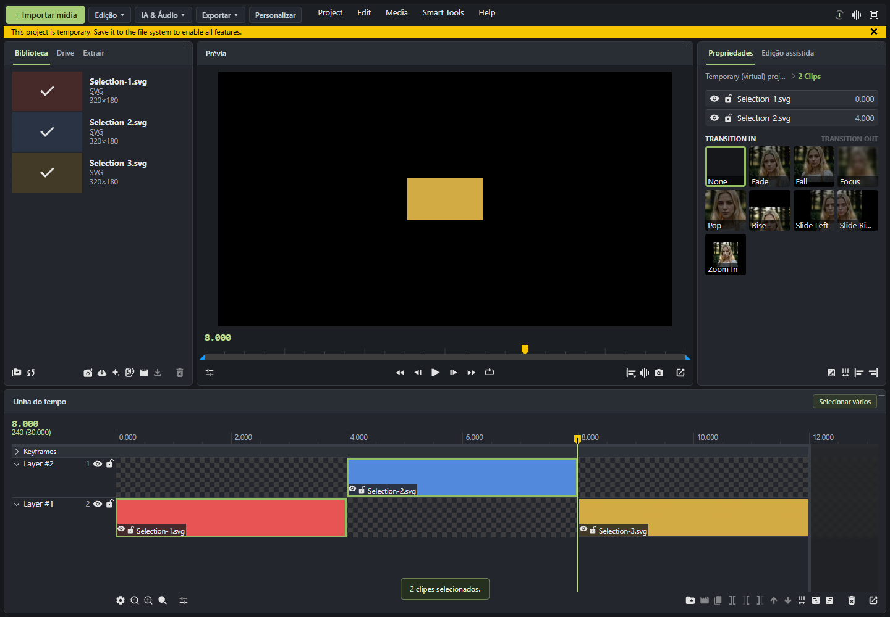
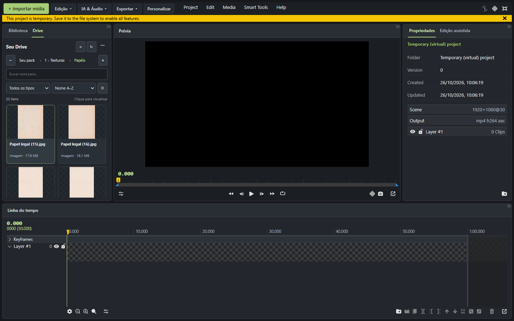
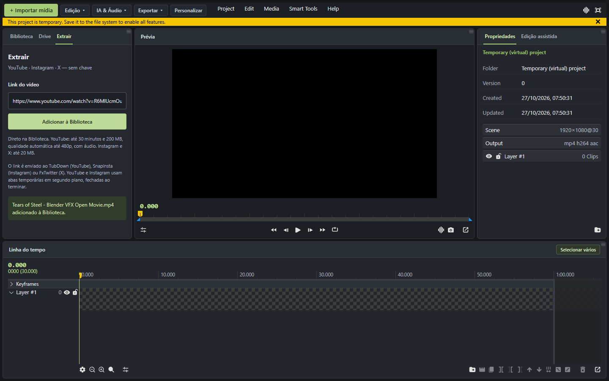
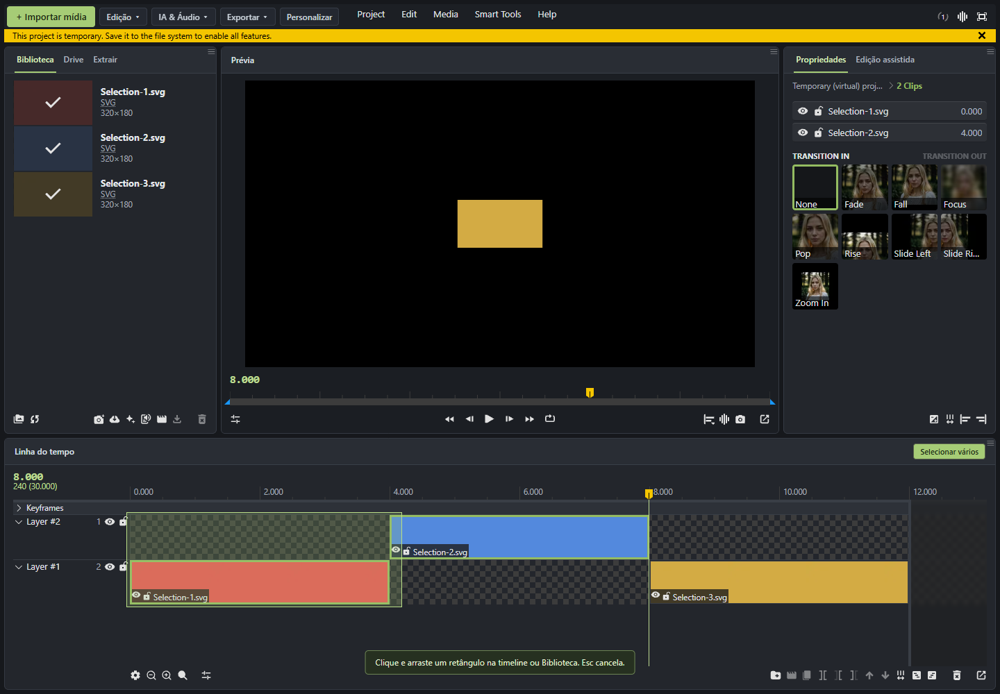

# Wide Studio

Uma extensão para deixar o [wide.video](https://wide.video/) mais simples de usar no dia a dia, com interface organizada, acesso ao Drive e importação de vídeos por link.



## O que adicionamos

- **Interface mais direta:** Biblioteca à esquerda, prévia no centro, propriedades à direita e linha do tempo embaixo.
- **Menus personalizáveis:** organize ações em pastas, mude a ordem dos atalhos e esconda menus que você não usa.
- **Importar mídia à mão:** botão no topo para acessar a importação do editor.
- **Drive dentro do editor:** navegue por pastas públicas, veja miniaturas e prévias, filtre arquivos e marque pastas favoritas.
- **Arrastar do Drive para a timeline:** escolha o arquivo e solte na camada e no tempo desejados.
- **Extrair por link:** cole um link público de YouTube, Instagram ou X e adicione o vídeo à Biblioteca.
- **Seleção de vários clipes:** arraste um retângulo e veja a seleção acompanhar o movimento, inclusive ao diminuir. Funciona entre camadas e na Biblioteca.
- **Atalhos de seleção:** Shift adiciona à seleção anterior, Esc cancela o retângulo e dois cliques rápidos no espaço vazio da timeline desselecionam.
- **Navegação e pontos salvos:** vá para um tempo exato e guarde posições para voltar depois.
- **Acesso às ferramentas do wide.video:** atalhos para cortar, desfazer, abrir remoção de silêncio, legendas e exportação.

## Prints

### Drive: encontre a mídia antes de importar

Miniaturas, busca, filtros e navegação por pastas públicas. Apenas o arquivo escolhido é importado; a extensão não sincroniza a pasta inteira.



### Extrair: cole o link e adicione à Biblioteca

YouTube aceita vídeos de **até 30 minutos e 200 MB**, com áudio e qualidade automática até 480p. Instagram e X têm limite de 20 MB. A extensão usa serviços externos; alguns links podem não estar disponíveis.



### Selecione vários clipes com um retângulo

A seleção muda durante o arrasto. Depois, você pode mover os clipes selecionados em grupo usando o comportamento nativo do editor.



Os prints foram feitos no editor real, em projetos temporários de teste. O print do Drive é de uma versão anterior da interface; as abas e os recursos mais recentes aparecem nos demais prints.

## Instalar no navegador

1. Baixe o ZIP da [última versão](https://github.com/ryuclover/wide-studio/releases/latest) e extraia em uma pasta permanente.
2. Abra a página de extensões: `chrome://extensions`, `edge://extensions` ou `opera://extensions`.
3. Ative o **Modo do desenvolvedor**.
4. Clique em **Carregar sem compactação** e selecione a pasta **extensao**, onde está o `manifest.json`.
5. Abra um projeto no [wide.video](https://wide.video/app/1.7.12/).

Para atualizar, substitua os arquivos da extensão, clique em **Recarregar** na página de extensões e recarregue também o wide.video. Mantenha a pasta extraída no computador.

## Como usar

**Drive:** abra a aba Drive, navegue por uma pasta pública e clique em um arquivo para ver a prévia. Use Adicionar ou arraste para a timeline. Imagens estáticas grandes podem usar uma cópia leve. Não é preciso conectar uma conta Google para navegar em pastas públicas.

**Extrair:** abra a aba Extrair, cole o link e clique em Adicionar à Biblioteca. Autorize o domínio do serviço quando o navegador solicitar. Depois, use o vídeo como qualquer mídia da Biblioteca. Não precisa configurar conector local, Drive ou chave de API para esse fluxo.

**Selecionar vários:** clique no botão da timeline e arraste o retângulo. Shift preserva a seleção anterior; Esc restaura o grupo anterior; duplo clique no espaço vazio limpa a seleção.

**Personalizar:** use o botão Personalizar no topo para organizar as pastas de ações e a visibilidade dos menus.

## Edição assistida: estado atual

A aba Edição assistida tem chat, leitura do contexto do projeto e configuração opcional de NVIDIA NIM com sua própria chave. A execução pelo chat está limitada às ações que a ponte realmente confirma, como mover a posição de reprodução.

**Cortar silêncio, gerar legendas e buscar/inserir imagens automaticamente pelo chat ainda não estão implementados.** Os atalhos de silêncio e legendas abrem as ferramentas do próprio wide.video.

## Limites e armazenamento

- Desenvolvida e testada com **wide.video 1.7.12**. Mudanças no site podem exigir atualização da extensão.
- A aba Drive usa pastas públicas e pode mostrar uma lista parcial em pastas muito grandes. Originais têm limite de 20 MB.
- YouTube: até 30 minutos, 200 MB e 480p. A qualidade escolhida depende do que o serviço oferece dentro do limite.
- Extração usa TubDown, Snapinsta e FxTwitter. Mudanças, indisponibilidade ou verificação humana nesses serviços podem impedir a importação. A extensão não resolve CAPTCHA.
- A mídia importada ocupa memória e pode ocupar o armazenamento/cache do projeto. Não é edição por streaming direto do Drive. O fluxo Extrair evita uma cópia extra na pasta Downloads.
- Chaves pessoais não acompanham o código nem o pacote. A configuração de IA é opcional.

## Desenvolver e testar

Requer Node.js e npm. No Windows, o empacotamento usa PowerShell.

```sh
cd extension
npm ci
npm run typecheck
npm test
npm run test:ui
npm run build
```

O resultado do build fica em `extension/dist`. Carregue essa pasta como extensão para testar suas mudanças.

Para gerar ZIP e checksum no Windows:

```sh
cd extension
npm run release
```

O comando cria `release/Wide-Studio-VERSAO.zip`. Ele não sobrescreve uma pasta de versão existente.

Os testes automatizados incluem validação de seleção, troca de projeto, importação em partes, limites de duração e tamanho e interface. Também foram feitos testes reais no navegador: importação completa de um vídeo de **12min14s com áudio**, seleção durante o arrasto, movimento de grupos e desseleção por duplo clique. O teste de transferência importou um arquivo sintético de **21 MB**, acima do limite antigo.

Os scripts de testes reais em `extension/tests/*Live.mjs` usam um Chrome de teste em `extension/.browser/`, que precisa ser preparado separadamente. Essa pasta não é distribuída. Os testes com serviços externos dependem da disponibilidade deles.

## Organização do código

- `extension/src/content`: interface sobre o site, importação e seleção.
- `extension/src/bridge` e `extension/src/adapter`: leitura do projeto e comunicação com o editor.
- `extension/src/extract`: resolução de links e transferência dos vídeos.
- `extension/src/ui`: telas de Drive, Extrair, navegação e edição assistida.
- `extension/tests`: testes automatizados e scripts de testes reais.
- `companion`: código legado de um conector local experimental; não é necessário para a aba Extrair atual e não acompanha o ZIP.
- `tools`: ferramentas usadas no mapeamento técnico do editor.
- `PROXIMOS-PASSOS.md`: acompanhamento técnico do projeto.

Projeto independente, sem vínculo oficial com wide.video, TechSmith, Google, NVIDIA ou os serviços de extração. O editor e os serviços externos pertencem aos respectivos responsáveis.
