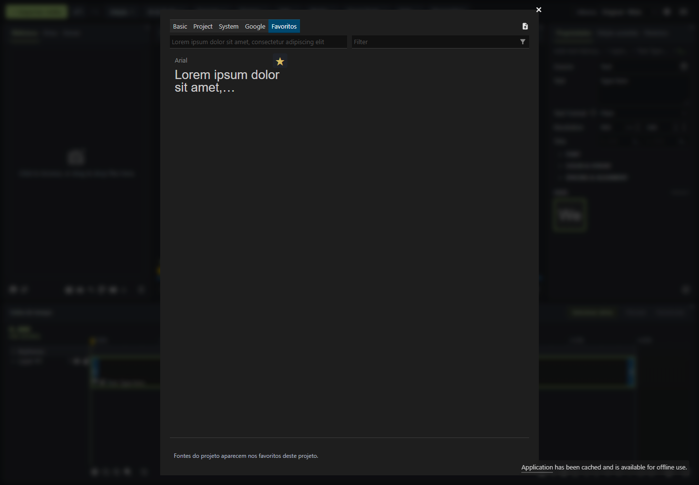
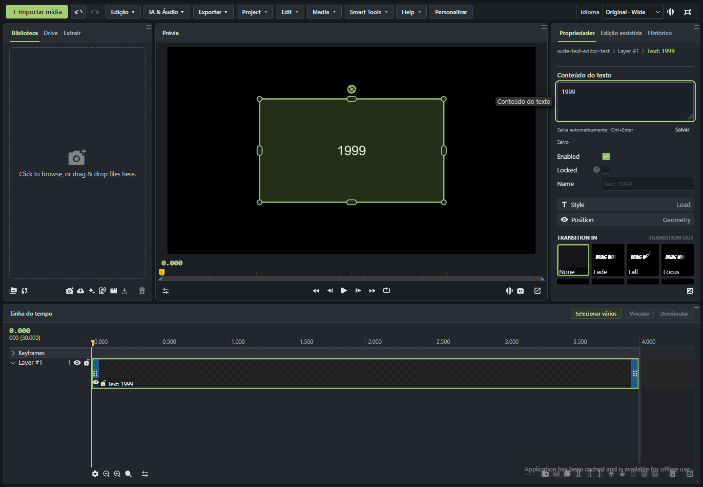
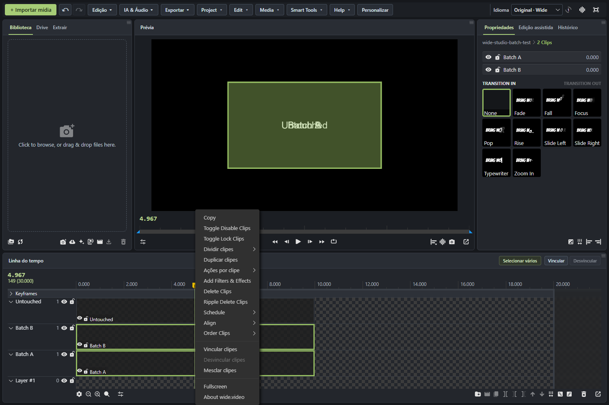
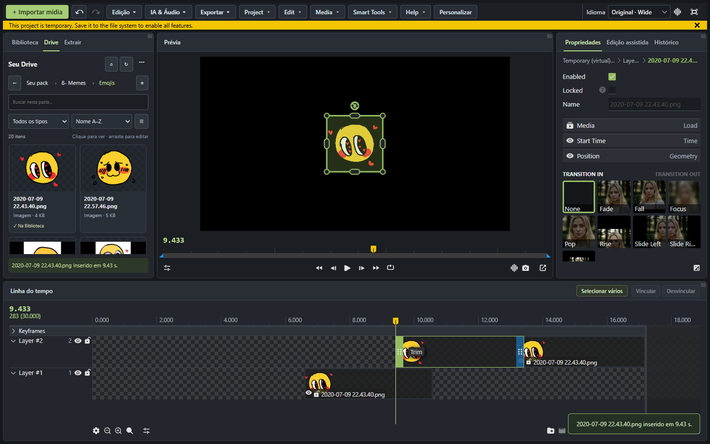
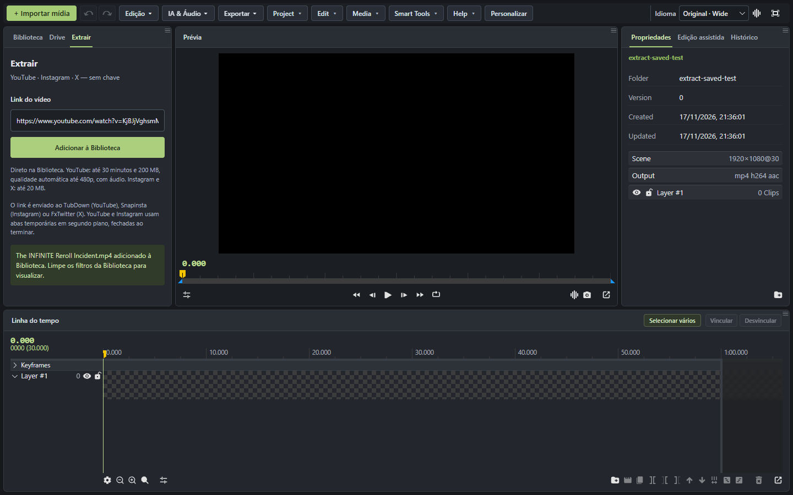
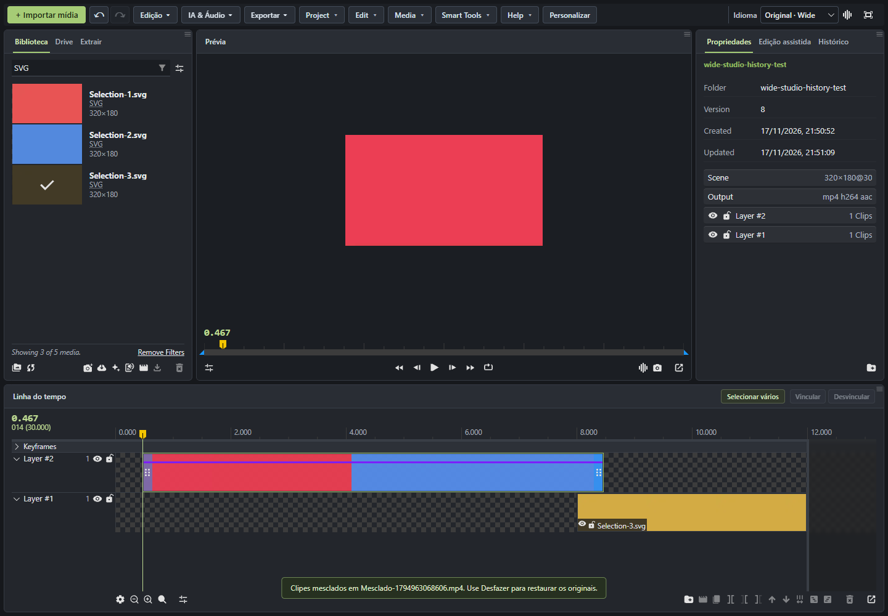

# Wide Studio

A Chromium extension that adds workflow tools to [wide.video](https://wide.video/app/1.8.0/): public Drive browsing, video import by URL, timeline selection, linked clips, clip merging, accessible undo/redo, interface translation, direct text editing and favorite fonts.

[Download the latest release](https://github.com/ryuclover/wide-studio/releases/latest) · [0.18.0 validation record](docs/validation-0.18.0.html)

## Install

1. Download and extract the release ZIP into a permanent folder.
2. Open `chrome://extensions`, `edge://extensions` or `opera://extensions`.
3. Enable Developer mode, choose **Load unpacked**, and select the package's `extensao` folder.
4. Open or reload [Wide 1.8.0](https://wide.video/app/1.8.0/). Pin the extension icon to reopen its navigation panel.

When updating, replace the files in the folder already registered in the browser, click **Reload** on the extensions page, then reload the editor. Keep that folder in a permanent location; renaming or deleting it breaks an unpacked installation. This release was tested in Chrome for Testing on Windows. Edge and Opera support has not been separately verified in this run.

## New in 0.18.0

- **Favorite fonts:** a Favorites tab beside Google in the native font selector. Use the star on any font to save or remove it. Local and Google favorites persist in the browser; imported font files are scoped to their project.
- **Text in Properties:** edit selected text without clicking inside the canvas. The native preview updates while typing, saves are grouped after a pause, and formatting, cursor position and undo are preserved.
- **Multiple-clip actions:** split, duplicate and apply filters/effects to selected or linked clips from the context menu. Per-clip actions remain available for commands that need one source.
- **Workflow fixes:** flush pending text before undo, preserve linked groups across batch cuts and refresh older unpacked installation folders when building a release.

Wide **1.8.0** is the maintained editor target. Older compatibility code remains in the repository, but Wide 1.7 is no longer a maintained or validated target for new releases.

## Features

| Tool | Workflow |
| --- | --- |
| Public Drive | Browse the public pack or another public folder, search/filter/sort, preview, save folder favorites and drag an asset directly onto the timeline. Only import the assets you need. |
| Extract | Paste a public YouTube, Instagram or X video URL and add it to the Library. The current flow uses external download websites; no local connector is required. |
| Multiple selection | Drag a rectangle in the timeline or Library. Selection updates while dragging. Shift adds, Escape cancels, and double-clicking empty timeline space clears selection. |
| Multiple-clip editing | Split or duplicate the selection, apply raw filters/effects to the set, and use per-clip actions for operations needing a single source. Linked groups participate even with one member selected; cuts create separate linked halves. Batch edits support one-step undo. |
| Linked clips | Select multiple clips and link/unlink from the timeline toolbar or right-click menu. Moving either member moves its group while preserving offsets. |
| Merge clips | Select multiple clips and choose **Mesclar clipes** from the right-click menu. Review native export settings, render the selected interval and replace the originals with one media clip after verification. |
| Undo, redo and history | Use the toolbar arrows and the History inspector tab. Compatible timeline movements restore directly; other actions use native snapshot restoration. |
| Favorite fonts | Open the font selector and click ☆ on a font, then use Favorites beside Google. Click ★ to remove it. Marking a favorite does not apply the font or close the selector. |
| Inspector text editing | Edit text directly in Properties, with live preview while typing, grouped background saves, stable focus/cursor, preserved formatting and native undo/redo. |
| Editing shortcuts | Import media, split clips, ripple delete, create text directly, open native silence/caption tools and export through the top toolbar. Clip deletion does not require a confirmation dialog. |
| Customize | Reorder and hide menu groups while keeping native Wide actions available. Preferences survive reload. |
| Languages | Choose Original, English, Portuguese (Brazil), Spanish, French or German. Portuguese has the broadest coverage; untranslated strings retain their original text. |
| Navigation and saved points | Navigate by frame/time and save named positions per project. Points are stored locally and can be backed up as JSON. |
| Assisted editing | Local navigation requests and an optional NVIDIA provider. Plans require explicit application; unsupported edits are not silently executed. |

### Favorite fonts



Favorites retain native font previews and search. They are stored locally in the browser, not in an online account. Project font favorites reference the original file; they do not copy or embed it into another project.

### Edit text in Properties



Select a text clip and edit **Text content** at the top of Properties. Multiline text is supported. Preview updates use Wide's native text-filter pipeline; autosave runs separately after a pause. **Save** or **Ctrl+Enter** saves immediately. Locked clips or layers are read-only.

### Edit several clips together



Right-click a selection or linked group to split at the playhead, duplicate, or apply filters/effects. Batch cuts keep the left and right halves in separate linked groups. **Per-clip actions** exposes commands requiring one source; batch operations keep a single undo step.

### Public Drive



Drive access is for public folders and requests optional Google media permissions. It does not authenticate a private Google Drive account. Original imports are limited to 20 MB; large static images can use an explicit light copy. Imported media can still consume browser cache or project storage. Large folder listings may be partial.

### Extract video by URL



YouTube supports up to 30 minutes and 200 MB, with automatic MP4 quality up to 480p and audio. Instagram and X support up to 20 MB. YouTube uses TubDown, Instagram uses Snapinsta, and X uses FxTwitter. Temporary provider tabs are closed after completion. No automatic duplicate is saved to Downloads.

Availability depends on the external provider and the specific public post. Private, unavailable, blocked or unsupported links can fail. Browser/project storage is still needed for editing.

### Merge selected clips



Merging renders the selection's full time span, including gaps, with the native Wide engine. The generated file is verified before sources are removed. One undo restores the originals. MP4 output does not preserve transparency. Linked clips remain a separate, non-rendering feature.

### Interface translation


Translation preserves user file and project names and does not replace the native editor's actions. Small interface changes are translated incrementally rather than rescanning the whole page.

## Integration and source layout

Wide 1.8.0's public API supplies project reads, verified navigation and direct text creation. Selection, links, native selected-clip rendering and other gaps retain isolated compatibility integrations. Wide 1.8.0 is the maintained target; older compatibility code has not been removed yet.

- `extension/src/features/timeline/`: selection, linked clips, merging and history.
- `extension/src/features/inspector/`, `fonts/`: direct text editing and persistent font favorites.
- `extension/src/integrations/wide/`: official API client and native compatibility boundaries.
- `extension/src/core/`: shared operation queue, editor invalidation and history batching.
- `extension/src/bridge/`: validated communication between page and extension contexts.
- `extension/src/drive/`, `extract/`, `ui/`, `i18n/`: media services, interface and translation.
- `extension/tests/`: automated regression checks and real-editor browser tests.

API operations are serialized because Wide rejects overlapping operations. Writes are not automatically retried. Native snapshot undo may still reconstruct the project where direct restoration is unsafe.

## Development and validation

From `extension/`:

```sh
npm ci
npm run build
npm test
npm run test:ui
```

Live scripts expect Chrome for Testing at `extension/.browser/chrome/win64-156.0.8078.47/chrome-win64/chrome.exe` and use synthetic projects in a disposable browser:

```sh
npm run test:live
npm run test:external
```

The default and maintained live-test target is Wide 1.8.0. Live logs are stored under ignored `.local/validation`; diagnostic captures are not published automatically. Headless permission grants affect only disposable test manifests, not the production package.

See the [0.18.0 validation record](docs/validation-0.18.0.html) for current checks. The release checks cover the automated regression/UI suites and focused real-editor checks for favorite fonts, text preview pixels during typing, text editing and batch clip actions. External downloads and credentialed NVIDIA inference are not re-run for this release; the [0.15.0 record](docs/validation-0.15.0.html) documents earlier external-service tests. Availability of those services can change.

Wide Studio is an independent project and is not an official wide.video product.
