<div align="center">

  # 🎬 Wide Studio
  **Supercharge seu fluxo de trabalho no [wide.video](https://wide.video) com recursos profissionais de edição direto no navegador.**

  <p align="center">
    <a href="#-visão-geral">Visão Geral</a> •
    <a href="#-recursos-em-destaque">Recursos</a> •
    <a href="#-galeria-visual--screenshots">Galeria Visual</a> •
    <a href="#-arquitetura--companion">Arquitetura & Companion</a> •
    <a href="#-como-instalar">Como Instalar</a> •
    <a href="#-desenvolvimento">Desenvolvimento</a>
  </p>

  <p align="center">
    
    
    
    
    
    
  </p>

</div>

---

## 📌 Visão Geral

O **wide.video** é um editor de vídeo open-source rápido e executado integralmente no navegador via WebCodecs e WebGL. 

O **Wide Studio** é uma extensão de navegador (Chrome / Chromium) desenvolvida para elevar o wide.video ao nível de uma suíte profissional de edição (estilo Premiere Pro / CapCut), eliminando gargalos clássicos de editores web:
- **Sem downloads manuais:** importe arquivos direto de pastas públicas do Google Drive para a timeline com drag-and-drop.
- **Seleção em lote:** manipule dezenas de clipes com seleção retangular (marquee).
- **Extração instantânea:** traga vídeos de redes sociais (YouTube, X, Instagram) direto para sua timeline com um clique via serviço local ultrarrápido.
- **Tradução completa e atalhos:** interface adaptada para Português (pt-BR) com personalização fina.

---

## ✨ Recursos em Destaque

| Recurso | Descrição |
| :--- | :--- |
| 📁 **Google Drive Integrado** | Navegue por pastas públicas do Google Drive, visualize thumbnails e arraste mídias direto para a timeline sem download prévio. |
| 🟦 **Seleção Múltipla & Marquee** | Clique e arraste na timeline para selecionar múltiplos clipes simultaneamente em uma caixa de seleção retangular. |
| ⚡ **Extração de Mídia Web (Companion)** | Cole URLs de vídeos públicos e importe para a biblioteca automaticamente via Native Messaging com pipeline local em FFmpeg. |
| 🔗 **Vínculo Inteligente de Clipes** | Vincule e desvincule faixas de áudio e vídeo (*Link / Unlink*) mantendo sincronismo perfeito de cortes e movimentação. |
| 🔇 **Silence Remover** | Analise formas de onda de áudio e corte automaticamente pausas e silêncios com precisão milimétrica. |
| 📌 **Pontos Salvos & Histórico Fluido** | Marcadores persistentes de cena e navegação histórica aprimorada (*undo / redo* inteligente com snapshots em lote). |
| 🇧🇷 **Localização em Português** | Tradução completa e consistente de menus, controles, timelines e painéis para português brasileiro. |

---

## 📸 Galeria Visual & Screenshots

### 1. Integração com Google Drive (Browser & Drag-and-Drop)
> Navegue por pastas compartilhadas e solte arquivos de áudio, imagem e vídeo diretamente nas faixas da timeline.

| Navegador de Arquivos do Drive | Drag-and-Drop direto na Timeline |
| :---: | :---: |
| 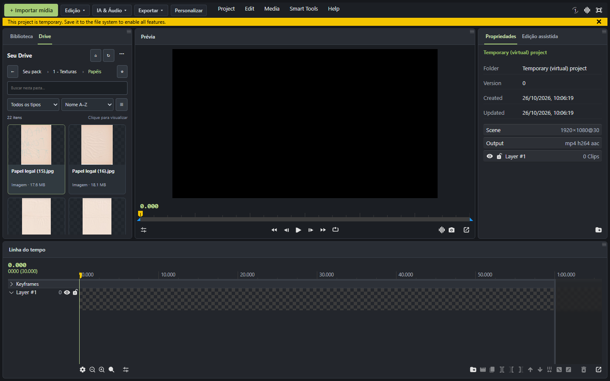 | 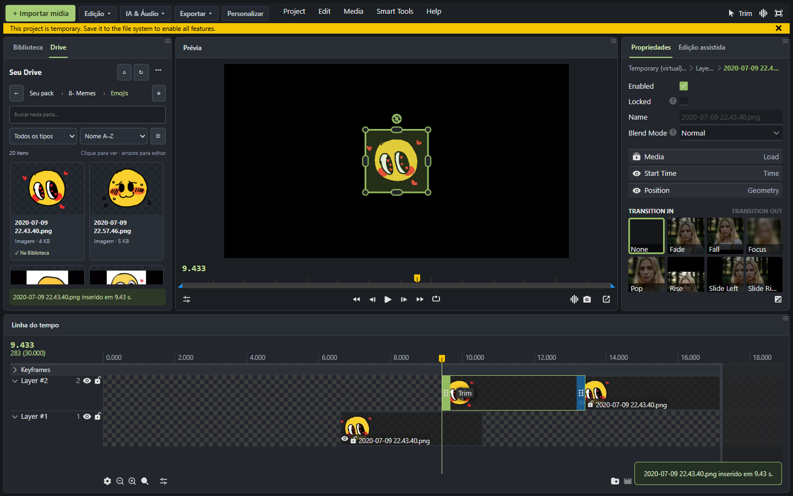 |

---

### 2. Seleção Múltipla & Seleção Retangular (Marquee Selection)
> Selecione dezenas de clipes com um único movimento de mouse e mova-os em bloco.

| Seleção Retangular Ativa | Múltiplos Clipes Selecionados |
| :---: | :---: |
| 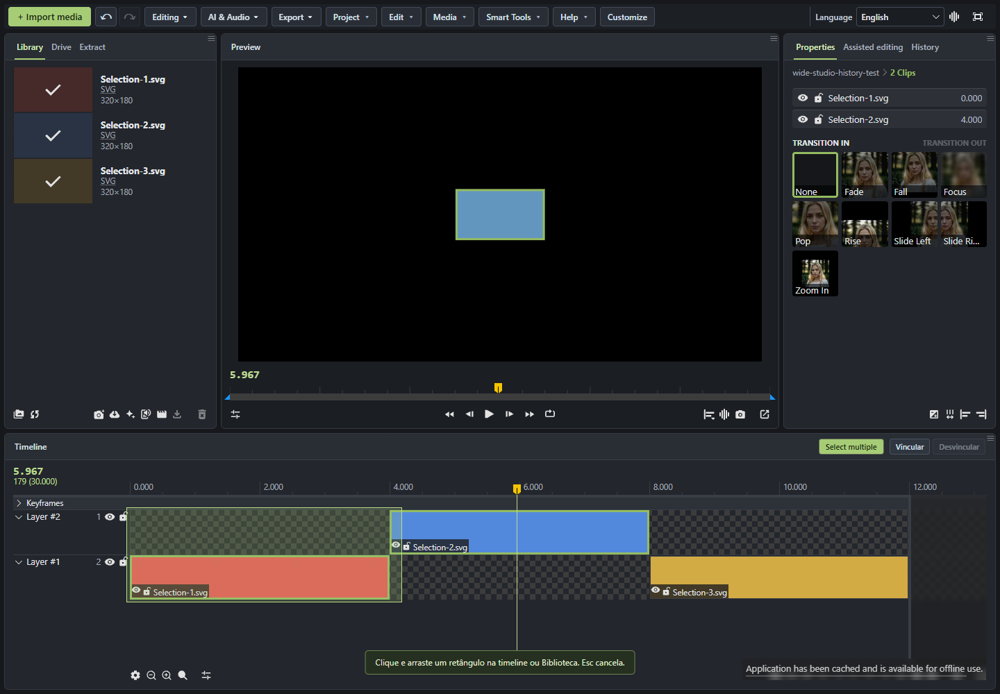 | 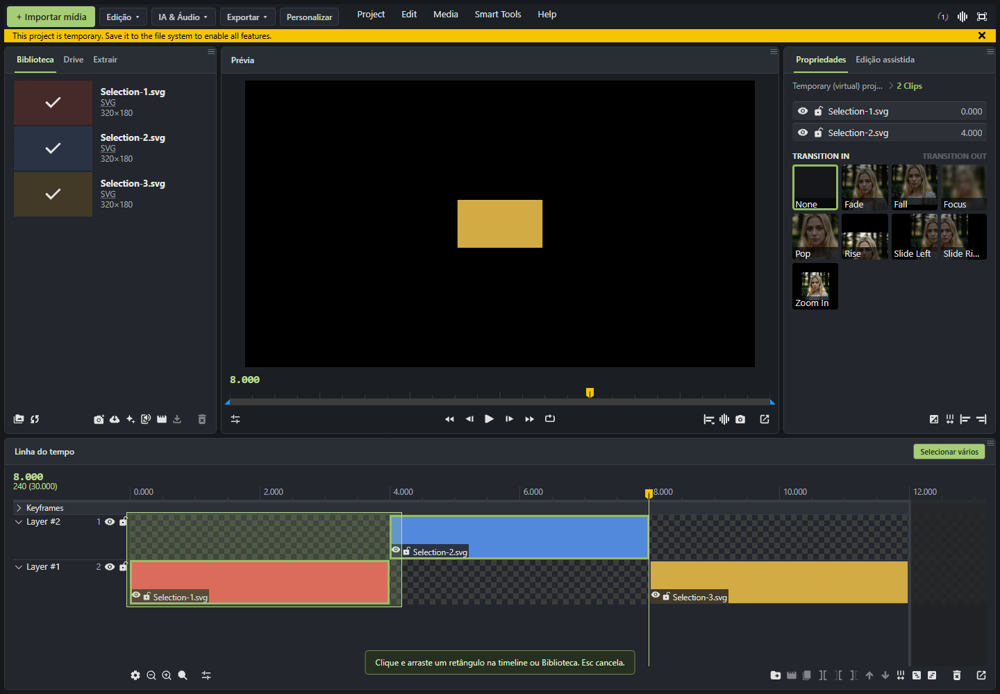 |

---

### 3. Extração Rápida de Mídias Web (Companion)
> Extraia mídias a partir de links públicos direto para o projeto, sem intermediários.

| Inserção de Link Público | Vídeo Extraído e Disponível no Projeto |
| :---: | :---: |
| 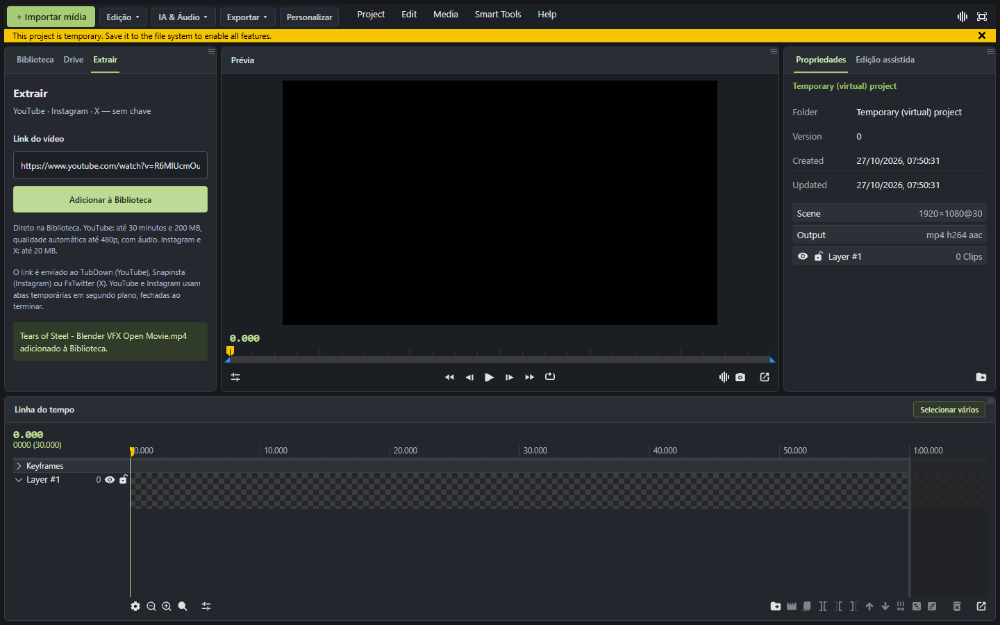 | 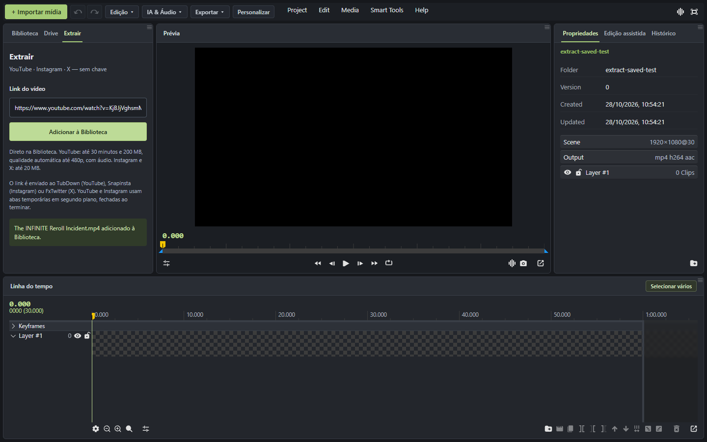 |

---

### 4. Ferramentas Avançadas de Timeline & Áudio
> Controle granular sobre links de clipes e detecção automática de silêncio para podcasts e vlogs.

| Detecção e Corte de Silêncio | Vínculo / Desvínculo de Áudio e Vídeo |
| :---: | :---: |
| 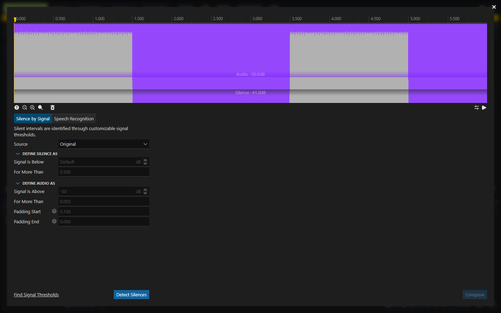 | 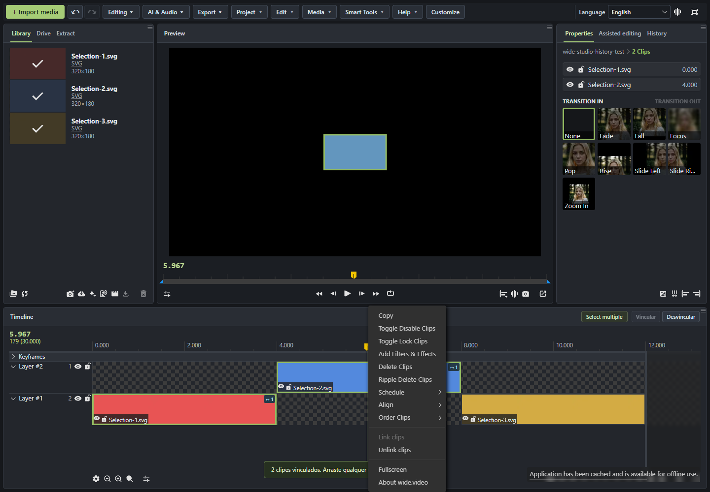 |

---

### 5. Produtividade, Pontos Salvos e Interface em Português
> Marcadores rápidos na timeline, histórico de ações e interface 100% em português.

| Pontos Salvos & Histórico de Edição | Interface Traduzida & Personalização |
| :---: | :---: |
| 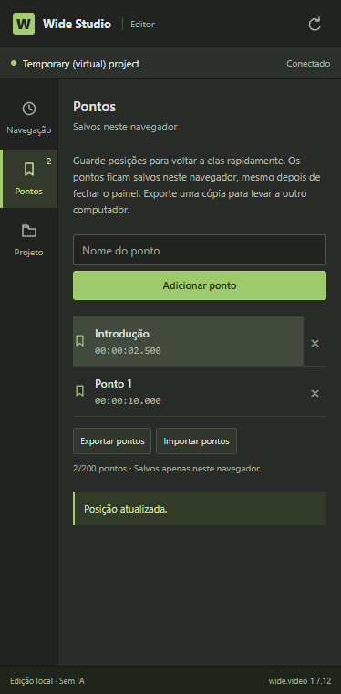 | 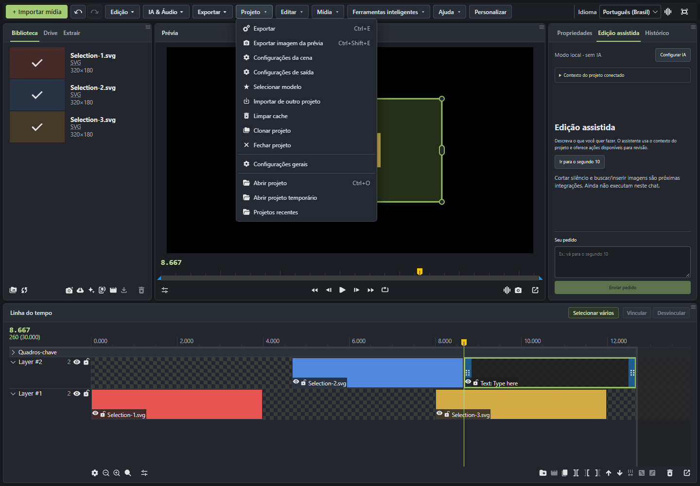 |

---

## 🏗️ Arquitetura do Sistema

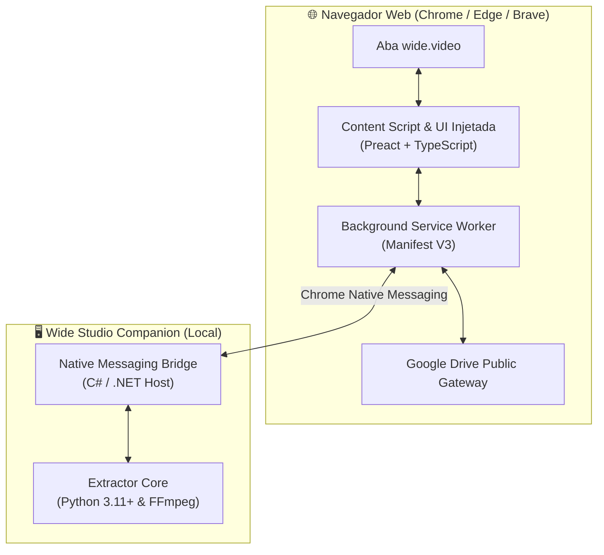

- **Content Scripts & Overlays:** Injeção leve em Preact que preserva a velocidade nativa do editor wide.video.
- **Isolated State & Bridge:** Comunicação assíncrona segura entre a página do editor e os módulos da extensão.
- **Companion Service (Opcional):** Host nativo em C# + Python que aproveita o poder do hardware local para tarefas pesadas de mídia com FFmpeg.

---

## 🚀 Como Instalar e Usar

### 1. Instalar a Extensão no Navegador

1. Clone ou baixe este repositório:
   ```bash
   git clone https://github.com/ryuclover/wide-studio.git
   ```
2. Acesse a pasta da extensão e construa o pacote:
   ```bash
   cd wide-studio/extension
   npm install
   npm run build
   ```
3. Abra seu navegador baseado em Chromium (Google Chrome, Brave, Edge):
   - Acesse `chrome://extensions/`
   - Ative o **Modo do desenvolvedor** no canto superior direito.
   - Clique em **Carregar sem compactação** (*Load unpacked*).
   - Selecione a pasta `wide-studio/extension/dist` (ou a pasta `extension`).
4. Acesse **[wide.video](https://wide.video)** e aproveite todas as funcionalidades ativas!

---

### 2. Ativar o Wide Studio Companion (Módulo de Extração Local)

Para habilitar a extração instantânea de vídeos de links públicos com processamento em lote via FFmpeg:

1. Tenha instalado no seu computador:
   - **Python 3.11+**
   - **FFmpeg** configurado no PATH
   - **Node.js 22+**
2. Acesse a pasta `companion/`:
   ```bash
   cd wide-studio/companion
   ```
3. Execute o script de configuração automática no Windows:
   ```cmd
   CONFIGURAR.cmd
   ```
   *(Este comando registra o manifesto do Native Messaging para comunicação segura e exclusiva com a extensão).*
4. Para iniciar ou parar o serviço a qualquer momento, utilize `INICIAR.cmd` e `PARAR.cmd`.

---

## 🧪 Testes e Qualidade

O projeto conta com uma suíte abrangente de testes de regressão de UI, overlay e integração:

```bash
cd extension

# Executar suíte de testes de regressão e bridge
npm test

# Executar testes visuais de interface (Preact / Happy-DOM)
npm run test:ui
```

---

## 👨‍💻 Autor

Desenvolvido por **[Gabriel (ryuclover)](https://github.com/ryuclover)**.  
Acesse o **[Guia dos meus projetos](https://github.com/ryuclover/Guia-dos-meus-projetos)** para conferir outros projetos e ferramentas!

