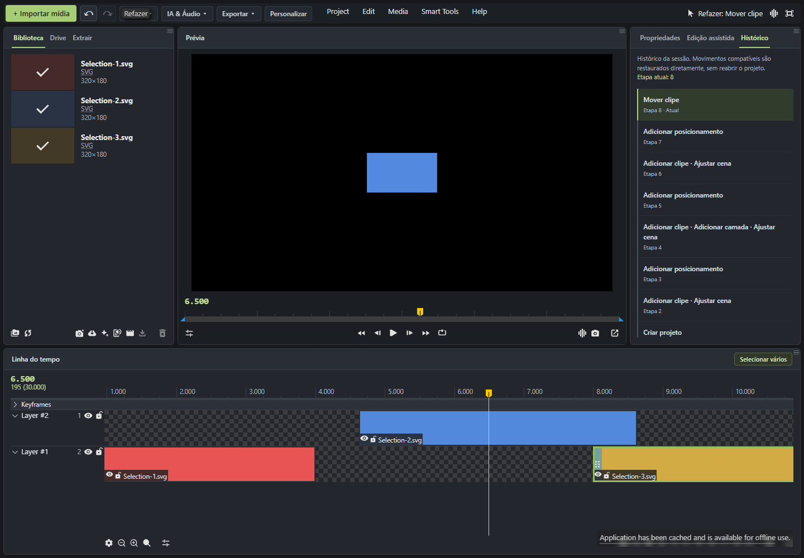
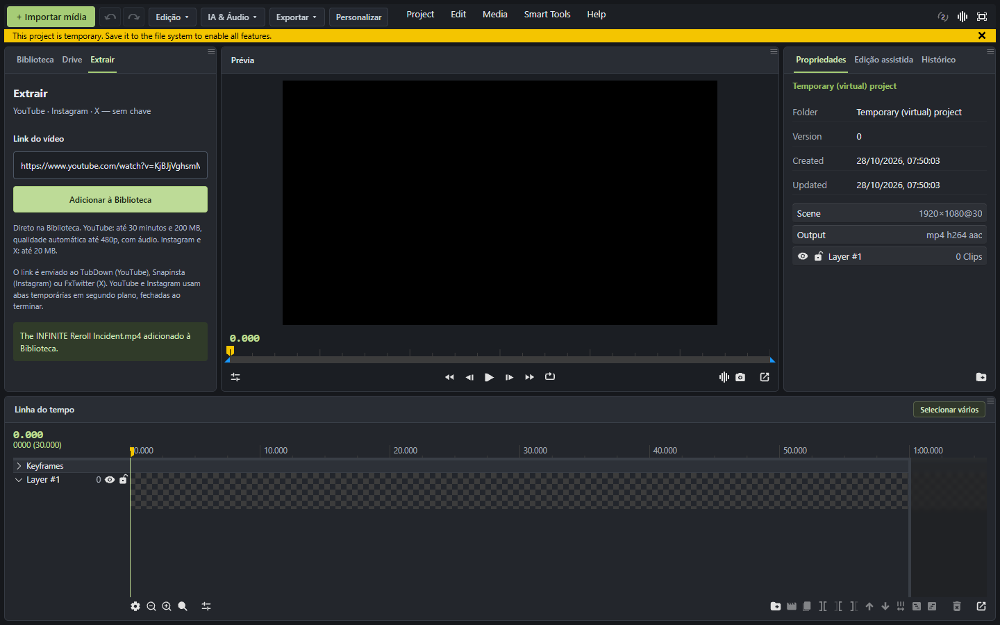

# Wide Studio

A browser extension that makes [wide.video](https://wide.video/) easier to use, with an organized workspace, public Google Drive browsing, video imports by URL, and accessible editing controls.


## Features

- **Organized workspace:** media on the left, preview in the center, properties on the right, and timeline below.
- **Customizable menus:** organize shortcuts into folders, reorder actions, and hide unused menus.
- **Quick import:** an Import media button beside the editor menus.
- **Public Google Drive folders:** browse thumbnails, preview files, search, filter, and save favorite folders without connecting a Google account.
- **Drive drag and drop:** drop a selected file onto a timeline layer at the desired time.
- **Import videos by URL:** paste a public YouTube, Instagram, or X link to add media to the Library.
- **Multiple selection:** drag a rectangle across clips or Library items. Selection updates while dragging; Shift adds to the existing selection, Esc cancels, and double-clicking empty timeline space clears it.
- **Undo, redo, and History:** accessible arrows and a session history tab. Compatible individual and group clip movements are restored directly without reconstructing the project. Other operations use the editor's native snapshot restoration.
- **Import progress and recovery:** extraction runs in a separate extension tab. Reopening Extract reconnects to the existing job instead of starting another download.
- **Navigation and saved points:** jump to an exact time and save positions for later.
- **Native tool shortcuts:** access the editor's split, silence removal, captions, and export tools.

## What's new in 0.10.0

Video extraction no longer depends on one long-lived extension message channel. This addresses imports failing with “the message channel closed before a response was received.” Longer videos have preparation and transfer progress and more time to finish.

Undoing compatible clip movements now preserves the active project, timeline zoom, scroll position, and playhead. Group movements are supported, with native snapshot fallback for other edits.



A real browser test imported **The INFINITE Reroll Incident**, approximately **20 minutes 44 seconds**, into the Library with audio at **854×480**. A separate test stopped the extension service worker and reopened Extract while a short import was running; it completed once, without a duplicate import. External services can still be slow or unavailable.



## Screenshots

### Browse Drive before importing

Only the selected file is imported. The extension does not synchronize entire folders.


### Select clips across layers

Selected clips can then be moved together using the editor's native behavior.


Screenshots were captured in real temporary test projects. Some show earlier interface versions. The extension interface is currently in Portuguese; this documentation is in English.

## Install

1. Download and extract the ZIP from the [latest release](https://github.com/ryuclover/wide-studio/releases/latest) into a permanent folder.
2. Open `chrome://extensions`, `edge://extensions`, or `opera://extensions`.
3. Enable **Developer mode**.
4. Choose **Load unpacked** and select **extensao**, the folder containing `manifest.json`.
5. Open a project in [wide.video 1.7.12](https://wide.video/app/1.7.12/).

To update, replace the extension files, click **Reload** on the browser's extensions page, and reload wide.video too. Keep the extracted folder on your computer.

## Usage

**Drive:** open Drive, browse a public folder, and click a file to preview it. Add it to the Library or drag it onto the timeline. Large still images may offer a lightweight copy.

**Extract:** paste a supported public video URL and click **Adicionar à Biblioteca**. Grant access to the service domain when prompted. Keep the editor and processing tab open until completion. Reopening Extract reconnects to progress. No local connector, API key, or Drive setup is needed.

**History:** use the top arrows to undo or redo. Open **Histórico** beside **Edição assistida** to inspect session steps. Compatible movements avoid project reconstruction; other operations still use native restoration.

**Customize:** use **Personalizar** to organize action folders and menu visibility.

## Assisted editing: current status

The Assisted editing tab includes chat, project context, and optional NVIDIA NIM configuration using your own key. Chat execution is limited to actions the integration can actually verify, such as moving the playhead.

**Automatic silence cutting, caption generation, and image search/insertion through chat are not implemented.** Silence and caption shortcuts open wide.video's own tools.

## Limits and storage

- Developed and tested against **wide.video 1.7.12**. Website changes may require extension updates.
- Drive browsing supports public folders. Very large folders may show partial listings. Original Drive imports have a 20 MB limit.
- YouTube imports: **up to 30 minutes, 200 MB, and 480p with audio**, depending on available formats. Instagram and X: 20 MB.
- Extraction uses TubDown, Snapinsta, and FxTwitter. Service changes, outages, or human verification can prevent imports. The extension does not solve CAPTCHAs.
- Imported media uses memory and may occupy project storage/cache. Drive editing is not direct streaming. Extract avoids an extra copy in Downloads.
- History is session-based and bounded to 20 states. Direct movement restoration is guarded; unsupported edits use native snapshots.
- Personal keys are excluded from the repository and release package. AI configuration is optional.

## Development and tests

Requires Node.js and npm. Windows packaging uses PowerShell.

```sh
cd extension
npm ci
npm run typecheck
npm test
npm run test:ui
npm run build
```

Load `extension/dist` as an unpacked extension to test the build.

```sh
cd extension
npm run release
```

This creates a versioned ZIP and SHA-256 checksum under `release/`. Existing version folders are not overwritten.

Automated tests cover project isolation, selection, chunked imports, limits, job recovery, UI behavior, history branching, and native fallback. Real browser tests cover long-video imports with audio, service-worker restart recovery, exact individual/group undo and redo, viewport preservation, deletion restoration, and project switching.

Live test scripts under `extension/tests/*Live.mjs` require a separately prepared test Chrome under `extension/.browser/`. It is not distributed. External-service tests depend on service availability.

## Code layout

- `extension/src/content`: workspace overlay, import integration, selection, and history.
- `extension/src/bridge` and `extension/src/adapter`: project inspection and editor communication.
- `extension/src/extract`: URL resolution, persistent jobs, and video transfer.
- `extension/src/ui`: Drive, Extract, navigation, and assisted editing interfaces.
- `extension/tests`: automated and real-browser test scripts.
- `companion`: legacy experimental local connector, not required by Extract and not included in the ZIP.
- `tools`: editor investigation utilities.
- `PROXIMOS-PASSOS.md`: technical project notes, currently in Portuguese.

Independent project, not officially affiliated with wide.video, TechSmith, Google, NVIDIA, or the extraction services.
