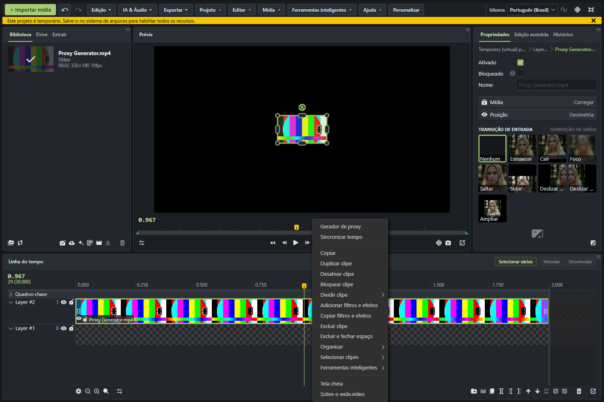

# Wide Studio

A Chromium extension that adds workflow tools to [wide.video](https://wide.video/app/1.8.0/): public Drive browsing, video import by URL, timeline selection, linked clips, clip merging, accessible undo/redo and interface translation.

[Download the latest release](https://github.com/ryuclover/wide-studio/releases/latest) · [0.15.0 validation record](docs/validation-0.15.0.html)

## Install

1. Download and extract the release ZIP into a permanent folder.
2. Open `chrome://extensions`, `edge://extensions` or `opera://extensions`.
3. Enable Developer mode, choose **Load unpacked**, and select the package's `extensao` folder.
4. Open or reload [Wide 1.8.0](https://wide.video/app/1.8.0/). Pin the extension icon to reopen its navigation panel.

When updating, load the new package's `extensao` folder and reload the editor. This release was tested in Chrome for Testing on Windows. Edge and Opera support has not been separately verified in this run.

## Features

| Tool | Workflow |
| --- | --- |
| Public Drive | Browse the public pack or another public folder, search/filter/sort, preview, save folder favorites and drag an asset directly onto the timeline. Only import the assets you need. |
| Extract | Paste a public YouTube, Instagram or X video URL and add it to the Library. The current flow uses external download websites; no local connector is required. |
| Multiple selection | Drag a rectangle in the timeline or Library. Selection updates while dragging. Shift adds, Escape cancels, and double-clicking empty timeline space clears selection. |
| Linked clips | Select multiple clips and link/unlink from the timeline toolbar or right-click menu. Moving either member moves its group while preserving offsets. |
| Merge clips | Select multiple clips and choose **Mesclar clipes** from the right-click menu. Review native export settings, render the selected interval and replace the originals with one media clip after verification. |
| Undo, redo and history | Use the toolbar arrows and the History inspector tab. Compatible timeline movements restore directly; other actions use native snapshot restoration. |
| Editing shortcuts | Import media, split clips, ripple delete, create text directly, open native silence/caption tools and export through the top toolbar. Clip deletion does not require a confirmation dialog. |
| Customize | Reorder and hide menu groups while keeping native Wide actions available. Preferences survive reload. |
| Languages | Choose Original, English, Portuguese (Brazil), Spanish, French or German. Portuguese has the broadest coverage; untranslated strings retain their original text. |
| Navigation and saved points | Navigate by frame/time and save named positions per project. Points are stored locally and can be backed up as JSON. |
| Assisted editing | Local navigation requests and an optional NVIDIA provider. Plans require explicit application; unsupported edits are not silently executed. |

### Public Drive


Drive access is for public folders and requests optional Google media permissions. It does not authenticate a private Google Drive account. Original imports are limited to 20 MB; large static images can use an explicit light copy. Imported media can still consume browser cache or project storage. Large folder listings may be partial.

### Extract video by URL


YouTube supports up to 30 minutes and 200 MB, with automatic MP4 quality up to 480p and audio. Instagram and X support up to 20 MB. YouTube uses TubDown, Instagram uses Snapinsta, and X uses FxTwitter. Temporary provider tabs are closed after completion. No automatic duplicate is saved to Downloads.

Availability depends on the external provider and the specific public post. Private, unavailable, blocked or unsupported links can fail. Browser/project storage is still needed for editing.

### Merge selected clips


Merging renders the selection's full time span, including gaps, with the native Wide engine. The generated file is verified before sources are removed. One undo restores the originals. MP4 output does not preserve transparency. Linked clips remain a separate, non-rendering feature.

### Interface translation



Translation preserves user file and project names and does not replace the native editor's actions. Small interface changes are translated incrementally rather than rescanning the whole page.

## Integration and source layout

Wide 1.8.0's public API supplies project reads, verified navigation and direct text creation. Selection, links, native selected-clip rendering and other gaps retain isolated compatibility integrations. The older 1.7.12 path remains available.

- `extension/src/features/timeline/`: selection, linked clips, merging and history.
- `extension/src/integrations/wide/`: official API client and native compatibility boundaries.
- `extension/src/core/`: shared operation queue, editor invalidation and history batching.
- `extension/src/bridge/`: validated communication between page and extension contexts.
- `extension/src/drive/`, `extract/`, `ui/`, `i18n/`: media services, interface and translation.
- `extension/tests/`: automated regression checks and real-editor browser tests.

API operations are serialized because Wide rejects overlapping operations. Writes are not automatically retried. Native snapshot undo may still reconstruct the project where direct restoration is unsafe.

## Development and validation

From `extension/`:

```sh
npm ci
npm run build
npm test
npm run test:ui
```

Live scripts expect Chrome for Testing at `extension/.browser/chrome/win64-156.0.8078.47/chrome-win64/chrome.exe` and use synthetic projects in a disposable browser:

```sh
npm run test:live
npm run test:external
```

Set `WIDE_TEST_VERSION=1.7.12` for compatible legacy scripts. Live logs are stored under ignored `.local/validation`; diagnostic captures are not published automatically. Headless permission grants affect only disposable test manifests, not the production package.

See the [validation record](docs/validation-0.15.0.html) for feature-by-feature coverage and practical limits. The current run includes real YouTube (20:44), Instagram and X imports, public Drive dragging, selected-clip rendering with decoded audio/video checks, languages, menus, timeline groups and undo/redo. NVIDIA transport is covered by automated fixtures; a new credentialed inference request was not run.

Wide Studio is an independent project and is not an official wide.video product.
