# Wide Studio

A browser extension that makes [wide.video](https://wide.video/) easier to use: a cleaner workspace, public Google Drive browsing, video imports by URL, linked clips, and accessible editing controls.

**Current version: 0.13.2** · [Download the extension](https://github.com/ryuclover/wide-studio/releases/latest) · [Installation](#install) · [Visual feature guide](#visual-feature-guide)

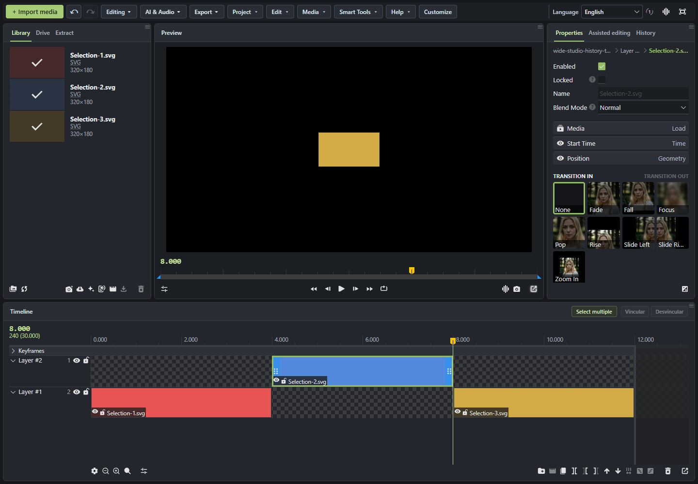

## What's new

- **Link clips:** connect clips across layers and drag either member to move the set. Link and unlink are available in the timeline header and the right-click menu for a multiple-clip selection.
- **More consistent rectangle selection:** start dragging on empty timeline space, including gaps and their × controls. Dragging does not activate the gap deletion action.
- **One-click text:** Add Text creates a native text clip without the intermediate creation dialog.
- **Unified, customizable menus:** reorder or hide native menus and shortcut folders from one list.
- **Interface languages:** Original, English, Brazilian Portuguese, Spanish, French and German. Portuguese coverage includes 963 phrases and templates, with additional shared translations. Coverage varies by language.
- **Editing flow:** accessible undo/redo, a History tab, clip deletion without confirmation, and more reliable long-video import receipts.

## Install

1. Download and extract the ZIP from the [latest release](https://github.com/ryuclover/wide-studio/releases/latest) into a permanent folder.
2. Open `chrome://extensions`, `edge://extensions`, or `opera://extensions`.
3. Enable **Developer mode** and choose **Load unpacked**.
4. Select **extensao**, the folder containing `manifest.json`.
5. Open a project in [wide.video 1.7.12](https://wide.video/app/1.7.12/).

To update, replace the extension files, click **Reload** on the browser's extensions page, then reload wide.video. Keep the extracted folder on your computer. No local connector is required for Drive or Extract.

## Visual feature guide

The screenshots below are real browser captures, not interface mockups. Current editing features use 0.13.2; Drive, extraction, navigation and native audio examples include earlier captures whose appearance may differ. Some interface text remains Portuguese even with English selected. The colored rectangles are small SVG test assets.

### 1. Cleaner workspace and quick media import

The Library stays on the left, Preview in the center, Properties on the right, and the timeline below. **Import media** is beside the main menus, so adding local files is always within reach. The extension keeps the native editor components and rendering engine in place.


### 2. Customizable menus and shortcut folders

Open **Customize / Personalizar**. Use the arrows to reorder native menus and shortcut folders; uncheck entries to hide them. Assign actions to folders, reorder shortcuts, or create another folder. **Save** persists the layout; **Cancel** discards pending changes.

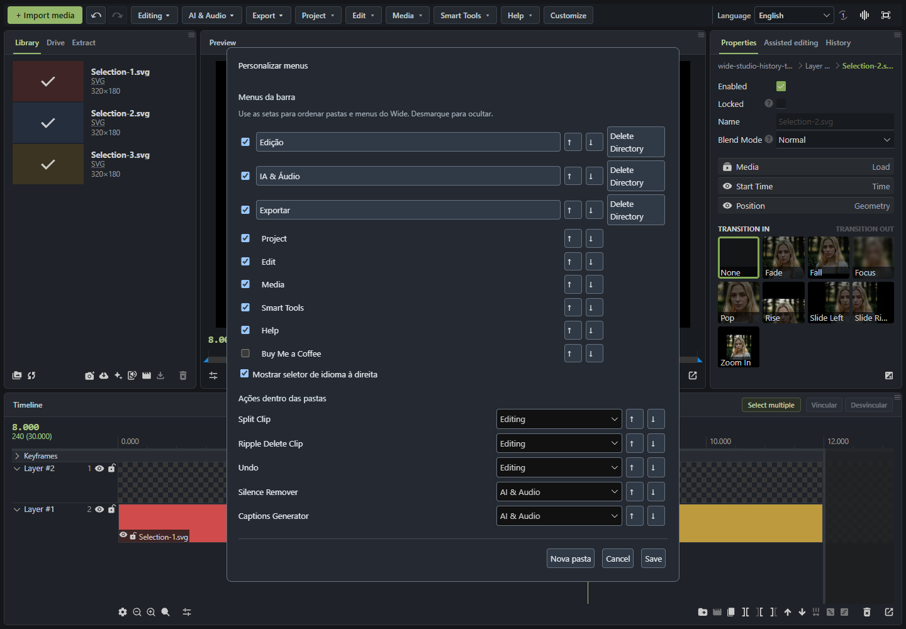

### 3. Public Google Drive browser

Open **Drive**, paste a public folder link, and browse its contents without connecting a Google account. Breadcrumbs navigate subfolders. Search, type filters, sorting, thumbnail/list views and favorite folders help you find a particular asset. Only selected files are imported; the folder is not synchronized.


### 4. Preview Drive files and import lighter images

Click an item to inspect it before importing. For supported oversized still images, the preview offers a smaller copy as an explicit alternative. The lighter copy can change resolution and sharpness; it is not the original file.

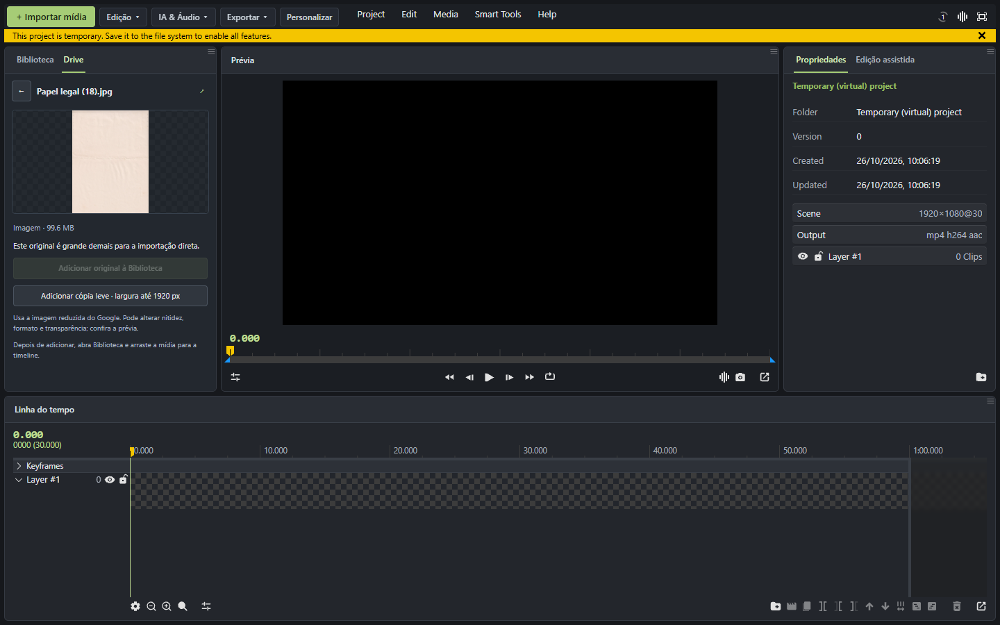

### 5. Drag Drive media onto the timeline

Drag a Drive card onto the desired timeline layer and time. The extension imports the chosen asset and inserts its clip at the drop location. The screenshot shows the imported item in the preview and its timeline placement. This is an import, not direct cloud streaming.

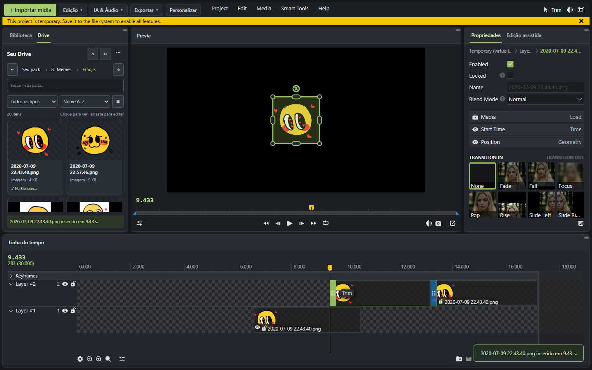

### 6. Extract videos by URL

Open **Extract / Extrair**, paste a supported public YouTube, Instagram or X link, and click **Add to Library / Adicionar à Biblioteca**. Grant the requested service-domain permission and keep the editor and processing tab open. Progress runs in a separate extension tab; reopening Extract reconnects to the current job instead of starting a duplicate.

YouTube currently allows **up to 30 minutes, 200 MB and 480p with audio**, depending on available formats. Instagram and X imports are limited to 20 MB. A real test imported a video of approximately **20 minutes 44 seconds** with audio. Availability depends on external services.

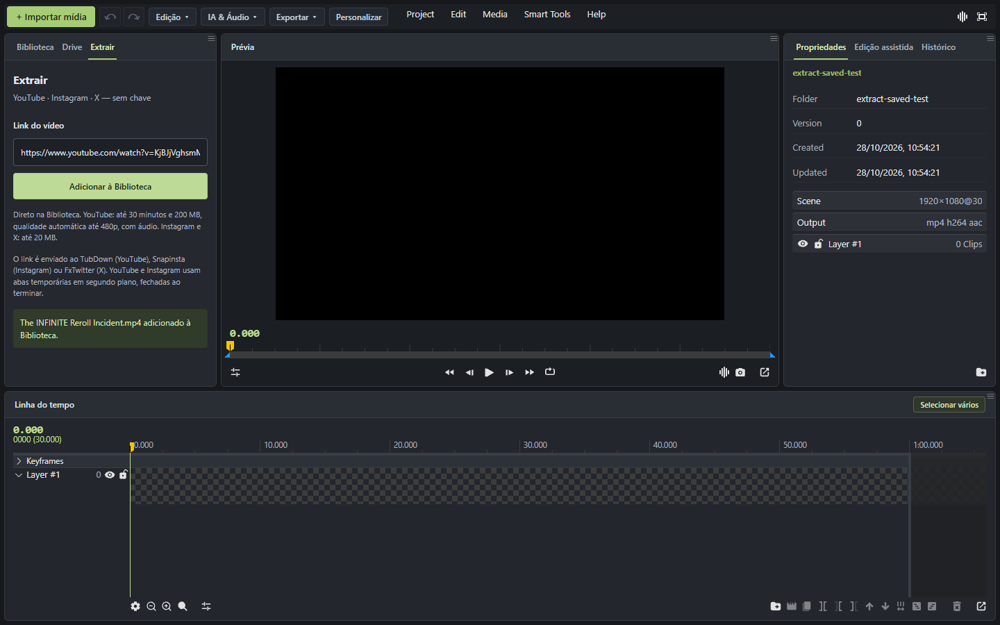

### 7. Rectangle selection across clips and layers

Drag from empty timeline space to select several clips. Gaps and their × controls also accept the gesture; once dragging begins, the gap's click action is suppressed. Selection updates while the rectangle grows or shrinks. **Shift** adds to the existing selection, **Esc** cancels, and double-clicking empty timeline space clears selection. The Library supports rectangle selection too.

Use **Select multiple / Selecionar vários** to explicitly arm the gesture when needed. Normal dragging on a clip keeps the native move behavior.

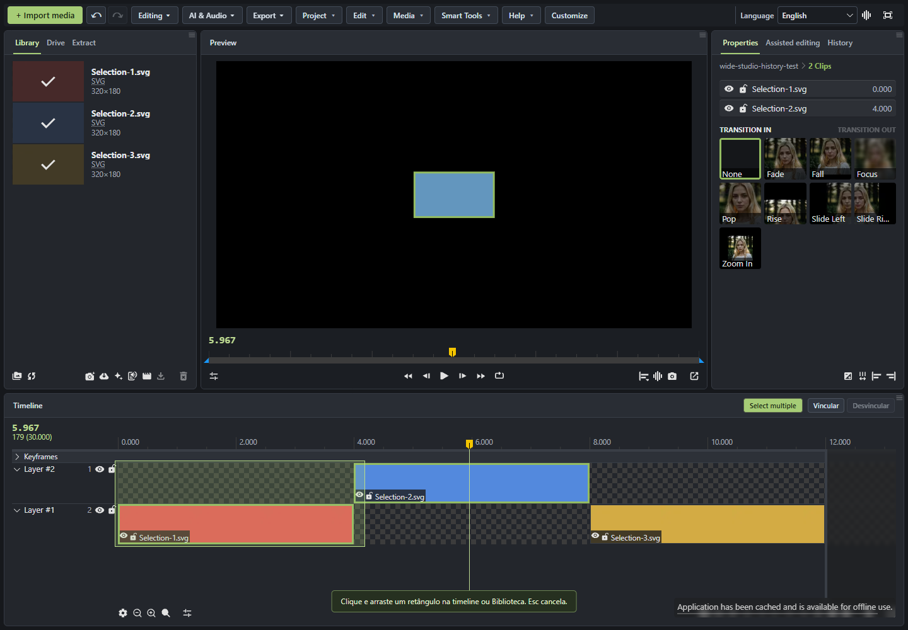

### 8. Link clips so they move together

Select two or more clips, then choose **Link clips** from the right-click menu, or **Vincular** in the timeline header. Drag either member: linked clips move together, preserving their time offset and layers. A blue numbered badge identifies the set. Linking overlapping sets merges them.

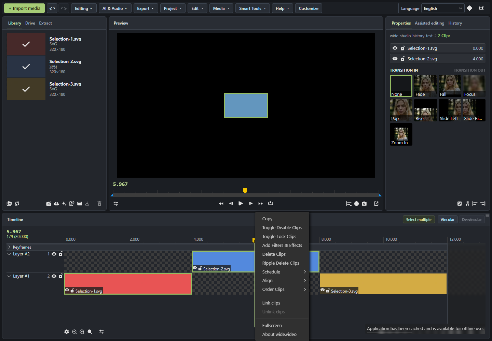

**Unlink clips / Desvincular** removes the selected set's link. The menu disables actions that do not apply. A locked member or layer blocks the set's drag, and the earliest member stops at time zero without collapsing the spacing.

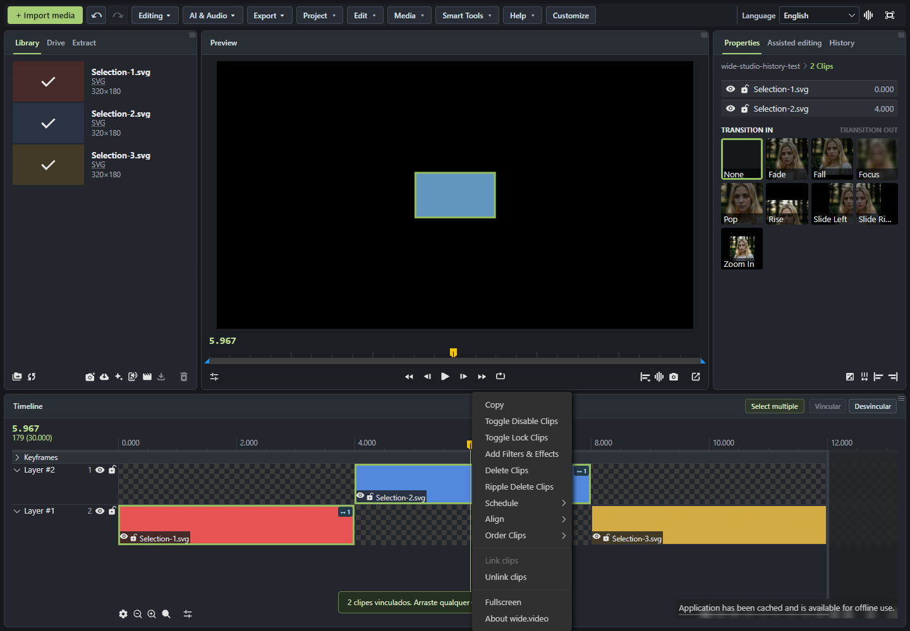

Links are saved locally for this project in this browser. They do not travel with an exported project. Ambiguous clip matches are not automatically reattached. Linking and unlinking are separate from native undo history. Only horizontal dragging is synchronized: trimming, cutting, deleting and keyboard movement remain individual operations. After unlinking, a still-active multiple selection can still move together through Wide's ordinary selection behavior.

### 9. Undo, redo and a visible action history

Use **↶ / ↷** beside Import media, or open the **History / Histórico** tab to inspect recent editing steps. Compatible individual and group movements are restored directly, preserving the active project and viewport. Other edits use Wide's native snapshot restoration. If a moved member is offscreen and cannot be fully tracked, restoration falls back to the complete snapshot rather than undoing only part of the group.

Clip deletion no longer asks for confirmation; use undo to recover it. File, media, folder and project deletion dialogs keep their native behavior. History is session-based and limited to 20 states.

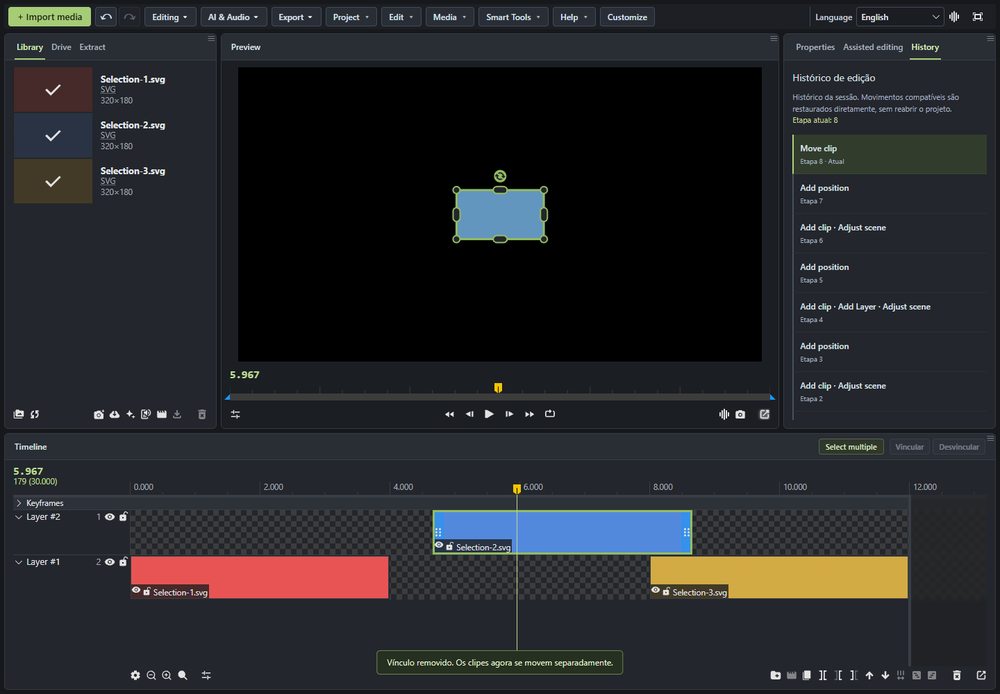

### 10. Add text in one click

Choose **AI & Audio → Add Text**. Wide Studio submits the native creation form automatically, using the editor's current layer and time defaults. Edit the new text through Wide's own text controls. The native creation action remains undoable.

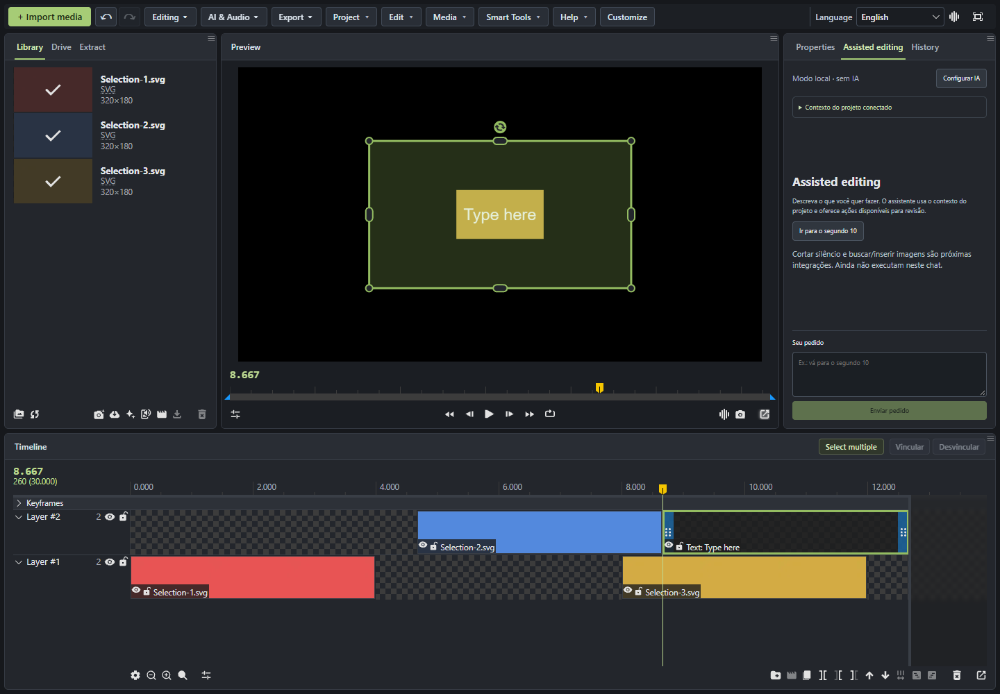

### 11. Change the interface language

Use **Language / Idioma** at the right of the top bar. The choice persists across reloads and synchronizes with embedded extension tabs. Portuguese covers menus, context menus, filters, properties, settings, transitions and common notifications. File names and project text are preserved; unsupported text falls back to the original.

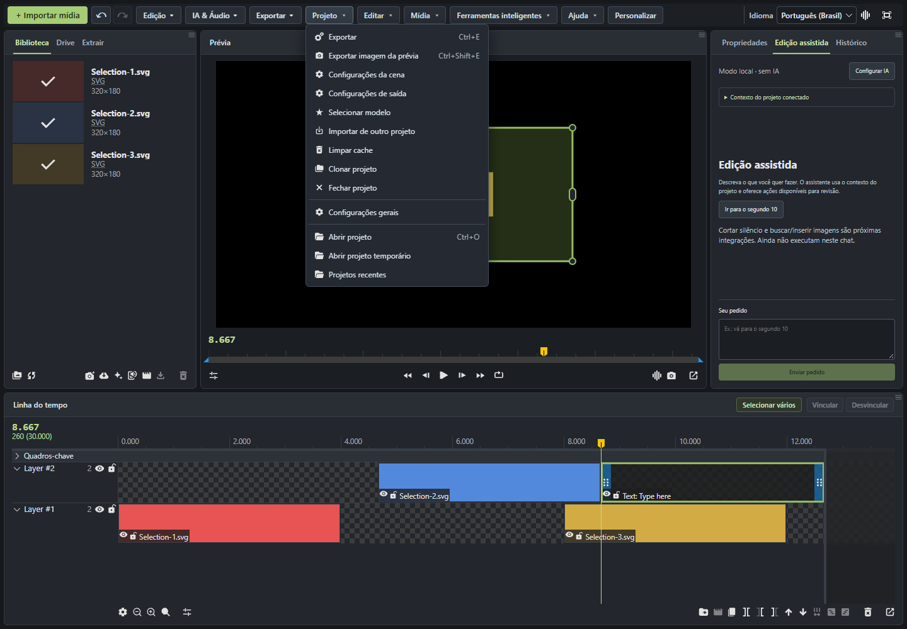

### 12. Native editing, audio and export shortcuts

Shortcut folders provide access to split, ripple delete, silence removal, caption generation, export video and capture image. These invoke **Wide's existing tools**; they are not new chat-based editing engines. Availability depends on the current selection and source media. Export uses Wide's native output settings.

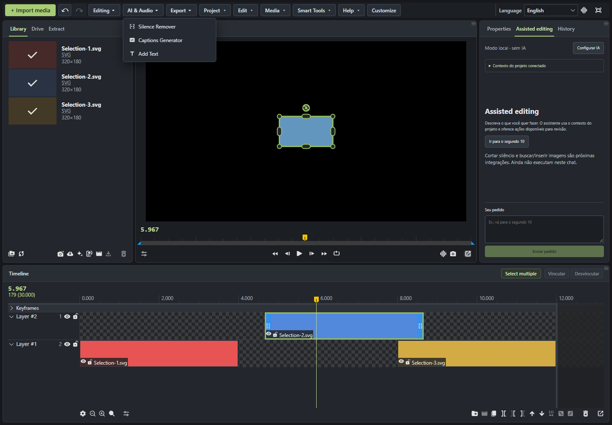

The native Silence Remover lets you inspect the waveform and adjust signal thresholds before composing a result. Caption generation uses Wide's native workflow and its requirements. The extension's shortcuts open these tools rather than applying an unreviewed chat command.

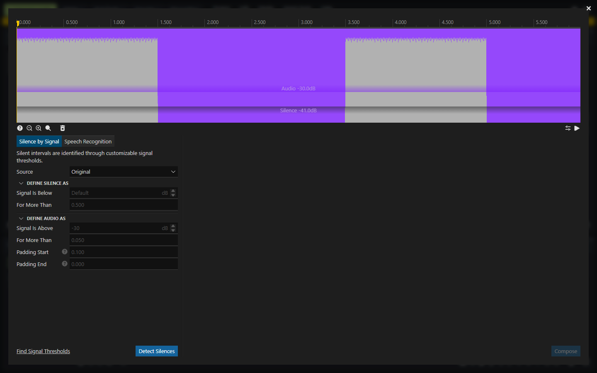

### 13. Exact navigation and saved points

The extension's navigation/points panel can jump to an exact time or frame and save named positions. Saved points can be revisited, removed, imported and exported. Points stay in this browser; export a copy to move them to another computer. The screenshot below shows the compact companion panel from an earlier version.

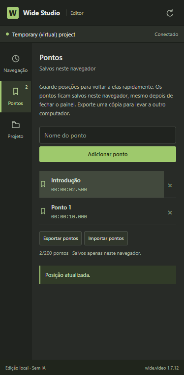

### 14. Assisted editing chat — experimental

Open **Assisted editing / Edição assistida** beside Properties. The panel exposes project context and optional NVIDIA NIM configuration using your own key. Execution is restricted to actions the integration can verify, such as playhead navigation. Requests require the available review/apply flow; unsupported operations are not reported as completed.

**Automatic silence cutting, caption generation and image search/insertion through chat are not implemented.** Use the native audio tools described above for those workflows. No API key is required for the rest of the extension.

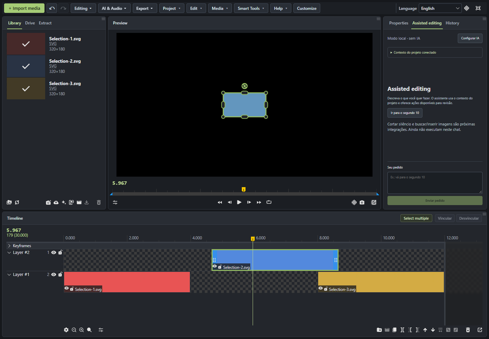

## Limits and storage

- Developed and tested against **wide.video 1.7.12**. Website changes may require an extension update. This is an overlay, not a fork or a complete public API for Wide's engine.
- Public Drive folders only. Large folders may return partial listings. Original Drive imports have a 20 MB limit; eligible images may offer an explicit smaller copy.
- Video extraction uses TubDown, Snapinsta and FxTwitter. Links are sent to the relevant provider. Outages, changed sites, missing formats or human verification can prevent imports. The extension does not solve CAPTCHAs or bypass private-content access.
- Imported media consumes memory and may occupy project storage/cache. Drive is not direct streaming; Extract avoids an additional manual copy in Downloads.
- Links, layout preferences, language and saved points are local. Clearing browser/site data can remove them. History is session-based.
- Personal keys, browser profiles and local diagnostic dumps are excluded from the repository and release. Optional AI configuration uses your own credentials.

## Development and tests

Requires Node.js and npm. Windows packaging uses PowerShell.

```sh
cd extension
npm ci
npm run typecheck
npm test
npm run test:ui
npm run build
```

Load `extension/dist` as an unpacked extension to test the build. To package it:

```sh
cd extension
npm run release
```

This creates a versioned ZIP and SHA-256 checksum under `release/`. Existing version folders are not overwritten.

Automated tests cover native-action targeting, project isolation, imports and receipts, job recovery, selection, linking, disabled/stale menu actions, language, menu customization and history. Real browser scenarios cover linking and unlinking from the context menu, movement, undo/redo, locks, the zero-time boundary, reload persistence and direct text creation, alongside earlier Drive and extraction checks. External-service tests are dependent on service availability.

Live scripts under `extension/tests/*Live.mjs` require a separately prepared Chrome under `extension/.browser/`, which is not distributed. `readmeScreenshotsLive.mjs` captures the current editing screenshots in a clean test project.

## Code layout

- `extension/src/content`: workspace, native actions, selection, links and history.
- `extension/src/bridge`: validated communication and native project snapshots.
- `extension/src/drive`: public folder browsing and bounded imports.
- `extension/src/extract`: extraction jobs, providers and transfer logic.
- `extension/src/i18n`: language preferences and local UI translations.
- `docs/screenshots`: reviewed screenshots used in this guide.
- `companion`: legacy experimental local connector; not required by Extract and not in the ZIP.
- `PROXIMOS-PASSOS.md`: technical project notes in Portuguese.

Independent project, not officially affiliated with wide.video, TechSmith, Google, NVIDIA or the extraction services.
